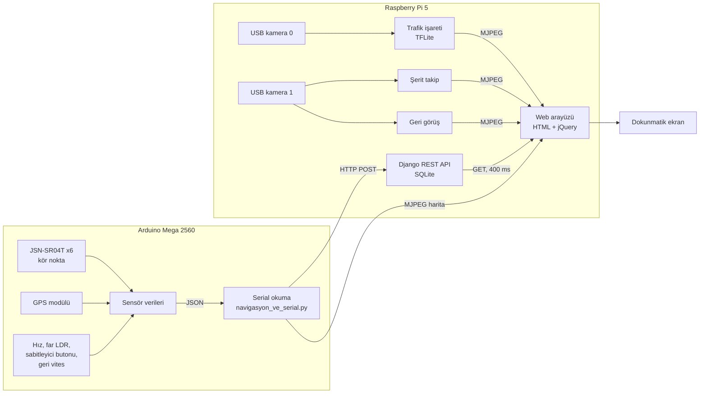

# Lexa-ADAS 🚗

**TEKNOFEST 2025 – Efficiency Challenge Elektrikli Araç Yarışları** kapsamında, **Lexa Team** olarak geliştirdiğimiz ileri sürücü destek sisteminin (**ADAS – Advanced Driver Assistance Systems**) yazılım tarafı.

Sistem; geri görüş kamerası, kör nokta uyarısı, trafik işareti algılama, şerit takip uyarısı, yarış navigasyonu, hız sabitleyici ve otomatik far olmak üzere **7 fonksiyonu** tek bir arayüzde toplar. Veriler Arduino Mega'dan okunur, Raspberry Pi 5 üzerinde çalışan **Django** sunucusuyla işlenir ve araç içindeki dokunmatik ekranda web arayüzü olarak gösterilir.

> 📦 **Proje durumu: Arşivlenmiştir (Archived).** Bu proje 2025 TEKNOFEST yarışma sezonunda geliştirilmiş olup artık aktif olarak sürdürülmemektedir. Kodda hatalar (bug) bulunabilir. Ayrıntılar için [Proje Durumu ve Sorumluluk Reddi](#proje-durumu-ve-sorumluluk-reddi) bölümüne bakınız.

| | |
|---|---|
| **Takım** | Lexa Team |
| **Yarışma** | TEKNOFEST 2025 – Efficiency Challenge Elektrikli Araç Yarışları |
| **Konu** | ADAS (İleri Sürücü Destek Sistemleri) |
| **Benim rolüm** | ADAS Ana Yazılım Direktörü |
| **Sonuç** | Teknofest Liseler Arası Efficiency Elektrikli Araç Yarışları Finalistliği |

---

## İçindekiler

- [Proje durumu ve sorumluluk reddi](#proje-durumu-ve-sorumluluk-reddi)
- [Fonksiyonlar](#fonksiyonlar)
- [Sistem mimarisi](#sistem-mimarisi)
- [Repo yapısı](#repo-yapısı)
- [Fonksiyonların çalışma şekli](#fonksiyonların-çalışma-şekli)
- [API ve veri modeli](#api-ve-veri-modeli)
- [Kurulum ve çalıştırma](#kurulum-ve-çalıştırma)
- [Tasarım kararları](#tasarım-kararları)
- [Bilinen sınırlamalar](#bilinen-sınırlamalar)
- [Kullanılan teknolojiler](#kullanılan-teknolojiler)

---

## Proje durumu ve sorumluluk reddi

Bu depo, 2025 yılında TEKNOFEST Efficiency Challenge Elektrikli Araç Yarışları kapsamında geliştirilen çalışmanın **arşiv niteliğindeki** bir kopyasıdır. Aşağıdaki hususlar kullanıcıların bilgisine sunulur:

1. **Bakım durumu:** Proje artık aktif olarak geliştirilmemekte ve sürdürülmemektedir. Hata bildirimleri ve değişiklik talepleri için herhangi bir güncelleme garantisi verilmemektedir.
2. **Hatalar:** Kod tabanı bilinen ve henüz tespit edilmemiş hatalar (bug) içerebilir. Bilinen sınırlamaların bir kısmı [Bilinen sınırlamalar](#bilinen-sınırlamalar) bölümünde listelenmiştir.
3. **Yapısal eksiklikler:** Proje, geliştirildiği dönemdeki tecrübe düzeyi ve yarışma takvimindeki zaman kısıtları çerçevesinde hazırlanmıştır. Bu nedenle kod yapısı, mimari ve kod kalitesi açısından kusursuz değildir; modülerlik, test kapsamı, hata yönetimi ve güvenlik gibi alanlarda iyileştirmeye açık noktalar mevcuttur.
4. **Mevcut hâliyle sunulma:** Yazılım, herhangi bir garanti verilmeksizin "olduğu gibi" (*as is*) sunulmaktadır. Yazılımın belirli bir amaca uygunluğu, kesintisiz veya hatasız çalışacağı konusunda taahhütte bulunulmamaktadır.
5. **Kullanım sorumluluğu:** Bu yazılım bir yarış aracında sürücüye bilgi vermek amacıyla geliştirilmiştir. **Gerçek trafikte veya güvenlik açısından kritik herhangi bir uygulamada kullanılması amaçlanmamıştır.** Kodun araçta ya da donanımla birlikte kullanılmasından doğabilecek her türlü sorumluluk kullanıcıya aittir.
6. **Arşivleme amacı:** Kod, geliştirme sürecini ve o dönemki yaklaşımı belgelemek amacıyla bilinçli olarak yeniden yazılmadan, orijinal hâline yakın biçimde muhafaza edilmektedir.

---

## Fonksiyonlar

| # | Fonksiyon | Ne yapar | Çalıştığı yer | Bu repodaki karşılığı |
|---|---|---|---|---|
| 1 | **Geri görüş kamerası** | Araç geri vitese alınınca kamera görüntüsünü ekrana getirir | Raspberry Pi 5 | `back_cam_stream` (`views.py`) |
| 2 | **Kör nokta algılama** | Araç yanındaki nesneleri ultrasonik sensörlerle algılar, ekranda uyarır | Arduino Mega + Raspberry Pi 5 | Arayüz tarafı (`back_cam.html`) |
| 3 | **Trafik işareti algılama** | Kamera görüntüsündeki trafik işaretlerini yapay zekâ modeliyle sınıflandırır | Raspberry Pi 5 | `tr_stream` (`views.py`) + `.tflite` model |
| 4 | **Şerit takip uyarısı** | Aracın şeritten çıkma eğilimini görsel olarak uyarır | Raspberry Pi 5 | `serit_takip.py` |
| 5 | **Yarış navigasyonu** | GPS konumunu 2B harita üzerinde gösterir ve tur sayar | Arduino Mega + Raspberry Pi 5 | `navigasyon_ve_serial.py` |
| 6 | **Hız sabitleyici** | Sürücünün seçtiği hızı sabit tutmak için röleyi kontrol eder | Arduino Mega | Yalnızca arayüzde gösterim |
| 7 | **Otomatik far** | Ortam ışığına göre farları açar/kapatır | Arduino Mega | Yalnızca arayüzde gösterim |

> **Not:** Arduino Mega üzerinde çalışan C/C++ kodları (sensör okuma, röle kontrolü, GPS işleme) **bu repoda yer almamaktadır**. Bu repo yalnızca Raspberry Pi 5 tarafındaki Python/Django yazılımını içerir. Şerit takip uyarısı aracın direksiyon sistemine müdahale etmez, yalnızca görsel uyarı verir.

## Sistem mimarisi



Akış kısaca şöyledir: Arduino sensör verilerini **JSON** olarak seri porttan gönderir, Python tarafı bunu okuyup Django REST API'ye POST eder. Web arayüzü her 400 ms'de bu verileri GET ile çeker ve ekranda gösterir. Kamera tabanlı fonksiyonlar (trafik işareti, şerit takip, geri görüş, navigasyon haritası) ise **MJPEG akışı** olarak doğrudan `` etiketlerine verilir.

**Donanım (rapora göre):** Raspberry Pi 5 (8 GB), Arduino Mega 2560, 7 inç Waveshare dokunmatik IPS ekran, U-blox Neo 7M GPS, 6 adet JSN-SR04T ultrasonik sensör (her yanda 3), Logitech Brio 300 ve Piranha 9635 USB kameralar, röle, LDR, buton ve potansiyometre.

## Repo yapısı

```
Lexa-ADAS/
└── lexa-code/
    ├── req.txt                       # Python bağımlılıkları
    └── lexa/
        ├── manage.py
        ├── db.sqlite3                # Hazır doldurulmuş veritabanı (id 1–13)
        ├── lexa/                     # Django proje ayarları (settings, urls)
        ├── static/js/jquery.js       # jQuery (internetsiz çalışmak için yerel kopya)
        ├── templates/
        │   └── back_cam.html         # Tek sayfalık sürücü arayüzü
        └── back_cam/                 # Ana uygulama
            ├── views.py              # API uçları + kamera/model akışları
            ├── models.py             # MainModel (name, value)
            ├── serializer.py         # DRF serializer
            ├── urls.py
            ├── serit_takip.py        # Şerit takip uyarısı (OpenCV)
            ├── navigasyon_ve_serial.py   # Serial okuma, GPS → harita, tur sayma
            ├── lexa_team_tf_test_v4.tflite   # Trafik işareti modeli
            └── a.png                 # Navigasyon için kullanılan harita görseli
```

## Fonksiyonların çalışma şekli

### Geri görüş kamerası

Arduino'dan gelen geri vites bilgisi (`id=6`) `0` olduğunda arayüz normal sürüş görünümünü gizler ve geri görüş akışını (960×480) gösterir. Görüntü, kamera akışından alınıp yatay çevrilerek (`cv2.flip`) MJPEG olarak verilir.

### Kör nokta algılama

Her yanda 3 adet (toplam 6) ultrasonik sensörün mesafe değerleri (cm) Arduino'dan gelir. Arayüz, bir yandaki sensörlerden herhangi biri **0 ile 150 cm arasında** bir değer okursa o tarafa "Araba Var" uyarısı yazar, aksi halde "Araba Yok" gösterir.

### Trafik işareti algılama

1. Kamera görüntüsünün üst-orta bölgesi (merkezden ±100 piksel genişlik) ilgi bölgesi (ROI) olarak kırpılır
2. ROI, `scikit-image` ile **32×32** boyutuna getirilir
3. Eğitilmiş **TensorFlow Lite** modeli (`lexa_team_tf_test_v4.tflite`) çalıştırılır
4. Çıktıdaki en yüksek olasılıklı sınıf, **olasılığı %70'in üzerindeyse** görüntünün üstüne yazılır

Model **9 sınıfı** ayırt eder: Hız limiti (20, 30, 50, 60, 70 km/s), Dur, Yol çalışması, Sağa dönüş, Sola dönüş.

### Şerit takip uyarısı

1. Kare 330×500'e küçültülür
2. Sol ve sağ tarafta iki ayrı **100×150** piksel ROI belirlenir
3. Her ROI'de HSV uzayında **beyaz renk** maskelenir (şerit çizgisi)
4. İki taraftaki beyaz piksel sayıları karşılaştırılır. Fark eşiği (500 piksel) aşılırsa, hangi tarafta daha fazla beyaz piksel varsa ona göre ekranda renkli bir daire ve yön oku çizilir

### Yarış navigasyonu

1. Arduino'dan JSON olarak `enlem` ve `boylam` değerleri okunur
2. GPS koordinatları, pistin köşelerine ait sabit enlem/boylam değerleriyle orantılanarak harita görselindeki (`a.png`, 810×344) piksel konumuna çevrilir
3. Araç, haritada 4×4 piksellik **mavi bir kare** olarak çizilir, geçtiği yol **gri çizgi** ile kaydedilir
4. Araç, daha önce geçtiği bir noktaya (1,2 piksel yakınlığa) geri döndüğünde **tur sayısı bir artırılır** ve kayıtlı yol temizlenir
5. Tur sayısı ve diğer sensör verileri API'ye POST edilir

### Hız sabitleyici ve otomatik far

Bu iki fonksiyonun mantığı (röle kontrolü, LDR eşiği) Arduino tarafında çalışır. Bu repodaki arayüz yalnızca hız değerini, sabitleyicinin açık/kapalı durumunu ve farın durumunu gösterir.

## API ve veri modeli

Tüm uçlar `/back_cam/` önekiyle çalışır.

| Endpoint | Metot | Açıklama |
|---|---|---|
| `/back_cam/` | GET | Sürücü arayüzü (tek sayfa) |
| `/back_cam/get_request` | GET | Tüm sensör/durum verilerini JSON olarak döner |
| `/back_cam/post_request` | POST | Sensör/durum verilerini veritabanına yazar |
| `/back_cam/nav` | GET | Navigasyon haritası MJPEG akışı |
| `/back_cam/serit_takip_stream/` | GET | Şerit takip MJPEG akışı |
| `/back_cam/tr_stream` | GET | Trafik işareti algılama MJPEG akışı |
| `/back_cam/back_cam_stream` | GET | Geri görüş kamerası MJPEG akışı |

**Veritabanı kayıtları (`MainModel`)** sabit `id` değerleriyle okunur/yazılır:

| id | Alan | Anlamı |
|---|---|---|
| 1–2 | enlem, boylam | Veritabanında yer alır, API tarafından kullanılmaz |
| 3 | hiz | Araç hızı |
| 4 | sabitonoff | Hız sabitleyici açık/kapalı |
| 5 | far | Far durumu (1 = açık) |
| 6 | gerivites | Geri vites (0 = geri vites aktif) |
| 7 | tur | Tur sayısı |
| 8–10 | engelsolbir / engelsoliki / engelsoluc | Sol taraf 3 sensör mesafesi (cm) |
| 11–13 | engelsagbir / engelsagiki / engelsaguc | Sağ taraf 3 sensör mesafesi (cm) |

**Arduino'nun seri porttan (9600 baud) gönderdiği JSON satırı** şu anahtarları içermelidir: `enlem`, `boylam`, `hiz`, `sabitonoff`, `far`, `geri`, `engelsolbir`, `engelsoliki`, `engelsoluc`, `engelsagbir`, `engelsagiki`, `engelsaguc`.

## Kurulum ve çalıştırma

> ⚠️ Kod, geliştirme sırasında **Windows** ortamında yazıldı ve gerçek donanım (Arduino Mega, USB kameralar) olmadan tam olarak çalışmaz. Çalıştırmadan önce [Çalıştırmadan önce değiştirmeniz gerekenler](#çalıştırmadan-önce-değiştirmeniz-gerekenler) bölümüne bakın.

```bash
git clone https://github.com/MelihKacan/Lexa-ADAS.git
cd Lexa-ADAS/lexa-code

python -m venv venv
# Windows:  venv\Scripts\activate
# Linux/macOS:  source venv/bin/activate

pip install -r req.txt

cd lexa            # Önemli: sunucu bu klasörden başlatılmalı
python manage.py runserver
```

Arayüz `http://127.0.0.1:8000/back_cam/` adresinde açılır. Navigasyon verisini API'ye taşıyan serial okuma işlemi, `/back_cam/nav` akışı açıldığında çalışır.

### Çalıştırmadan önce değiştirmeniz gerekenler

| Ne | Nerede | Açıklama |
|---|---|---|
| Model yolu | `back_cam/views.py` (`tflite_model_path`) | Yol, geliştirme bilgisayarına göre (`C:\Users\...`) sabit yazıldı. Kendi yolunuzla değiştirin |
| Çalışma dizini | `back_cam/navigasyon_ve_serial.py` | Harita `./back_cam/a.png` göreli yoluyla okunur, bu yüzden sunucu `lexa-code/lexa` klasöründen başlatılmalıdır |
| Kamera indeksleri | `views.py`, `serit_takip.py` | Trafik işareti için `0`, geri görüş ve şerit takip için `1` kullanıldı. Kendi kameralarınıza göre değiştirin |
| Arduino Mega | `navigasyon_ve_serial.py` | Port, açıklamasında "Arduino Mega" veya "2560" geçen cihaz olarak otomatik bulunur |
| Sunucu adresi | `navigasyon_ve_serial.py`, `back_cam.html` | `127.0.0.1:8000` sabit yazıldı |
| Bağımlılıklar | `req.txt` | `tensorflow-intel` Windows'a özgüdür. Raspberry Pi gibi ARM cihazlarda TensorFlow/TFLite için farklı paketler gerekir |

## Tasarım kararları

**Django ile arayüz.** Sensör verilerini işlemek, kamera görüntülerini ve yapay zekâ çıktılarını tek bir ekranda toplamak için, takımın tecrübesi olan Python/Django yığını seçildi. Arayüz araçta internet olmadığı için yerel ağda ve `localhost` üzerinde çalışır; bu nedenle jQuery de CDN yerine `static/js/jquery.js` olarak projeye dahil edildi.

**Arduino → Raspberry Pi arasında JSON.** Sensör okuma ve röle kontrolü gibi gerçek zamanlı işler Arduino'da, görüntü işleme ve arayüz gibi ağır işler Raspberry Pi'de tutuldu. İki taraf arasındaki veri, her dilde kolay işlenebilen JSON formatında seri port üzerinden taşındı.

**TensorFlow Lite.** Trafik işareti modeli ilk olarak Keras ile eğitildi, ancak Raspberry Pi için ağır bulunduğundan `.tflite` formatına dönüştürülerek çalıştırıldı.

**MJPEG akışı.** Kamera ve harita görüntüleri API üzerinden değil, `StreamingHttpResponse` ile doğrudan `` etiketine akıtıldı. Bu, ekstra istemci kodu gerektirmeden düşük gecikmeli bir gösterim sağlar.

## Bilinen sınırlamalar

Bu bir yarışma projesi olarak hızlı geliştirildiği için bazı kısımlar bugün farklı yazılırdı. Gelişimi göstermek amacıyla bilerek düzeltilmedi:

- **Tur sayacı hatası:** Mevcut konum, kayıtlı *tüm* noktalarla (en son nokta dahil) karşılaştırılıyor. Araç yavaşlayıp GPS değeri aynı piksel civarında kaldığında, gerçek bir tur tamamlanmadan tur sayısı artabilir. Doğrusu, en son birkaç noktayı hariç tutmak veya başlangıç noktası/çizgisi referans almaktır.
- **Kameraların çakışması:** Geri görüş ve şerit takip aynı kamera indeksini (`1`) kullanıyor ve arayüz açıldığında tüm akışlar birlikte yükleniyor. Aynı kameranın iki yerden birden açılması bazı sistemlerde hata verebilir.
- **Başlangıç bağımlılıkları:** Navigasyon modülü içe aktarılırken harita dosyası okunuyor ve seri port açılmaya çalışılıyor. Çalışma dizini yanlışsa sunucu başlamaz, Arduino bağlı değilse navigasyon akışı hata verir.
- **Sabit id'lere bağımlılık:** Veri `id=3..13` kayıtlarına göre okunup yazılıyor. Boş bir veritabanıyla başlanırsa kayıtlar farklı id'lerle oluşur ve arayüzdeki eşleşme bozulur. Repodaki hazır `db.sqlite3` kullanılmalıdır.
- **Eksik alanda hata:** `post_request`, 11 alanın tamamını zorunlu tutuyor. Arduino'dan herhangi biri eksik gelirse istek `500` hatası verir. Ayrıca bu fonksiyon 11 neredeyse aynı satırdan oluşuyor ve bir döngüyle çok daha kısa yazılabilir.
- **Sabit eşikler:** Şerit takibi için beyaz renk aralığı ve piksel farkı eşiği, trafik işareti için %70 olasılık eşiği sabit. Farklı aydınlatma ve kamera koşullarında sonuçlar değişebilir. Şerit takip yalnızca beyaz piksel sayısına bakıyor, çizgi geometrisini (eğim, kıvrım) hesaba katmıyor.
- **Sabit yol ve adresler:** Model yolu, harita yolu, kamera indeksleri ve sunucu adresi kod içinde sabit.
- **Bağımlılık çakışması:** `req.txt` içinde hem `serial` hem `pyserial` bulunuyor. İkisi aynı modül adını kullandığı için çakışabilir, yalnızca `pyserial` gereklidir.
- **Test yok:** Projede otomatik test bulunmuyor.
- **Güvenlik:** `settings.py` içinde geliştirme ortamı için `SECRET_KEY`, `DEBUG = True` ve boş `ALLOWED_HOSTS` bulunuyor. Gerçek bir yayında kullanılmamalı.
- **Eksik parçalar:** Arduino (C/C++) kodları bu repoda yer almıyor.

## Kullanılan teknolojiler

**Python:** Django, Django REST Framework, OpenCV, NumPy, TensorFlow / TensorFlow Lite, Keras, scikit-image, PySerial, Requests

**Web:** HTML, CSS, JavaScript, jQuery (AJAX)

**Gömülü:** Arduino (C/C++), ArduinoJson, TinyGPS

**Donanım:** Raspberry Pi 5, Arduino Mega 2560

## Lisans

Bu repo bir arşiv/portfolyo çalışmasıdır. Lisans henüz eklenmedi.
